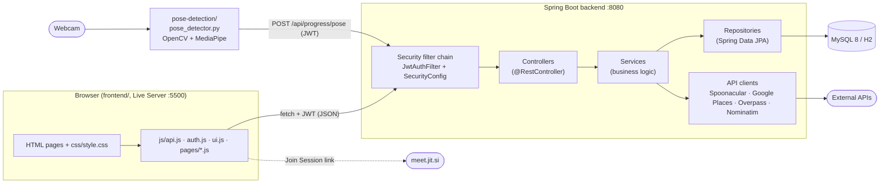

# FitFlex: Online Fitness Platform

> Final-year B.Tech major project. FitFlex connects users with certified trainers for online
> sessions, and adds personalised diet plans, a nearby-gym locator, progress tracking and
> ML-based pose detection with real-time posture feedback.

 
 


---

## Contents

1. [Features](#features)
2. [Tech stack](#tech-stack)
3. [Architecture](#architecture)
4. [Project structure](#project-structure)
5. [Prerequisites](#prerequisites)
6. [Setup on Windows](#setup-on-windows)
7. [Demo accounts](#demo-accounts)
8. [API keys (optional)](#api-keys-optional)
9. [Running the tests](#running-the-tests)
10. [Troubleshooting](#troubleshooting)
11. [Screenshots](#screenshots)
12. [Documentation](#documentation)

---

## Features

| Area | What it does |
|------|--------------|
| **Two portals** | Separate login/register for **users** and **trainers**; JWT authentication, BCrypt passwords, role-based access |
| **Trainers** | Public search by name, specialization, experience and price; profile page with weekly availability |
| **Online training** | Book one-on-one sessions (checked against availability and clashes); trainers confirm, and a **Jitsi Meet** video link is created; group classes with a capacity limit |
| **Coaching** | Trainers build multi-day **workout plans** for clients and **upload videos/documents** (mp4, pdf, docx, jpg, png) |
| **Nutrition** | **BMR (Mifflin-St Jeor) → TDEE → target calories**; meal plans from **Spoonacular**, or a built-in dataset of 41 Indian-friendly meals when no key is set; food search; macro chart |
| **Gym locator** | Nearby gyms on a map (Leaflet + OpenStreetMap, or Google Maps), with distance and directions. Data from Google Places if a key is set, otherwise free OpenStreetMap |
| **Progress** | Manual logs, streak, weight change, workout minutes, Chart.js charts |
| **Pose detection** | Python + OpenCV + MediaPipe: counts **squats** and **bicep curls**, times **planks**, shows "Correct posture" / "Wrong posture!!" and uploads the session to your progress |

Every external API has a fallback, so **the whole app works with zero API keys**.

## Tech stack

| Layer | Technology |
|-------|-----------|
| Frontend | HTML5, CSS3, vanilla JavaScript, Chart.js 4, Leaflet 1.9, Font Awesome 6, Poppins |
| Backend | Java 17, Spring Boot 4.2, Spring Web MVC, Spring Data JPA (Hibernate 7), Spring Security + JWT (jjwt 0.13), Bean Validation, Maven wrapper |
| Database | MySQL 8 (`fitflex_db`), or H2 in-memory (`h2` profile) |
| External APIs | Spoonacular, Google Places (New) / OpenStreetMap Overpass + Nominatim, Jitsi Meet |
| Pose detection | Python 3.11, OpenCV 4.11, MediaPipe 0.10.21, NumPy, Jupyter |
| Testing | JUnit 5, Mockito, MockMvc, pytest, Postman |

## Architecture



The backend uses a **layered architecture**: controllers only route and validate, services hold all
business logic, and repositories talk to the database. Controllers return **DTOs** (Java records),
never JPA entities. More detail is in the [Learning Guide](docs/LEARNING_GUIDE.md).

## Project structure

```
Fitflex_project/
├── backend/                     Spring Boot REST API
│   ├── src/main/java/com/fitflex/
│   │   ├── config/              SecurityConfig, CorsConfig, RestClientConfig, DataSeeder
│   │   ├── security/            JwtUtil, JwtAuthFilter, CustomUserDetailsService, UserPrincipal, RestAuthErrorHandler
│   │   ├── controller/          11 REST controllers
│   │   ├── service/             business logic + external API clients
│   │   ├── repository/          Spring Data JPA interfaces
│   │   ├── entity/              JPA entities + enums
│   │   ├── dto/request|response DTOs (records)
│   │   └── exception/           GlobalExceptionHandler + custom exceptions
│   ├── src/main/resources/      application.properties, application-h2.properties, fallback/meals.json, foods.json
│   ├── src/test/java/...        JUnit, Mockito and MockMvc tests
│   └── .env.example             copy to .env for your passwords/keys
├── frontend/                    16 HTML pages, css/style.css, js/ (api, auth, ui, pages/*)
├── pose-detection/              pose_detector.py, pose_utils.py, notebook, tests, README
├── docs/                        LEARNING_GUIDE.md, API.md, PROGRESS.md, Postman collection
└── README.md
```

## Prerequisites

| Tool | Version | Check | Notes |
|------|---------|-------|-------|
| Java JDK | 17+ | `java -version` | [Temurin 17](https://adoptium.net/) |
| Maven | not needed | | the project includes the Maven wrapper (`mvnw.cmd`) |
| MySQL | 8.x | `mysql --version` | optional: use the `h2` profile to skip it |
| VS Code + **Live Server** extension | any | | to serve the frontend on port 5500 |
| Python | 3.10 / 3.11 / 3.12 | `py -0p` | only for pose detection; MediaPipe does not support 3.13+ |
| Git | any | `git --version` | |

## Setup on Windows

All commands are for **PowerShell**, run from the project folder.

### 1. Backend

**Quick start without MySQL (H2 in-memory database):**

```powershell
cd backend
.\mvnw.cmd spring-boot:run "-Dspring-boot.run.profiles=h2"
```

The first run downloads Maven and the dependencies (a few minutes). When you see
`Started FitFlexApplication` and `Demo data ready`, the API is at <http://localhost:8080/api>.
Try <http://localhost:8080/api/trainers> in the browser. The H2 data is recreated on every start.

**With MySQL (data is kept between restarts):**

1. Make sure the MySQL service is running: `Get-Service MySQL80` (start it with `Start-Service MySQL80` as administrator).
2. Create your `.env` file and put your MySQL password in it:
   ```powershell
   cd backend
   Copy-Item .env.example .env
   notepad .env        # set DB_PASSWORD=... and, ideally, JWT_SECRET=<a long random string>
   ```
   The database `fitflex_db` is created automatically (`createDatabaseIfNotExist=true`), and Hibernate creates
   the tables (`ddl-auto=update`). Demo data is seeded only when the database is empty.
3. Run:
   ```powershell
   .\mvnw.cmd spring-boot:run
   ```

> Without `JWT_SECRET` a random key is generated at each start, so you have to log in again after a restart.
> Generate a secret in PowerShell:
> `[Convert]::ToBase64String((1..48 | ForEach-Object { Get-Random -Maximum 256 }))`

### 2. Frontend

```powershell
Copy-Item frontend\js\config.example.js frontend\js\config.js
```

Open the project folder in VS Code, right-click `frontend/index.html` → **Open with Live Server**.
It opens at `http://127.0.0.1:5500/frontend/index.html`.

> CORS allows `http://127.0.0.1:5500` and `http://localhost:5500` by default. If you serve the
> frontend from another port, add it to `CORS_ORIGINS` in `backend/.env`.

No VS Code? Any static server works, for example: `cd frontend; python -m http.server 5500 --bind 127.0.0.1`.

### 3. Pose detection (optional)

```powershell
cd pose-detection
uv venv --python 3.11 .venv                          # or: py -3.11 -m venv .venv
uv pip install --python .venv -r requirements.txt   # or: .venv\Scripts\pip install -r requirements.txt
.venv\Scripts\activate
python pose_detector.py                              # webcam; keys s / b / p / r / q
python pose_detector.py --upload --email user@fitflex.com --password User@1234
```

Full details, the notebook and troubleshooting: [pose-detection/README.md](pose-detection/README.md).

## Demo accounts

Created automatically when the database is empty (`DataSeeder`):

| Role | Email | Password | Details |
|------|-------|----------|---------|
| User | `user@fitflex.com` | `User@1234` | Rahul Verma, 24, 175 cm, 75.5 kg, weight loss, 4 weeks of progress |
| Trainer | `trainer1@fitflex.com` | `Trainer@1234` | Arjun Mehta · Strength · 8 yrs · ₹799 |
| Trainer | `trainer2@fitflex.com` | `Trainer@1234` | Priya Sharma · Yoga · 6 yrs · ₹599 |
| Trainer | `trainer3@fitflex.com` | `Trainer@1234` | Rohan Deshmukh · Weight Loss · 5 yrs · ₹699 |
| Trainer | `trainer4@fitflex.com` | `Trainer@1234` | Kavya Iyer · Zumba · 4 yrs · ₹499 |
| Trainer | `trainer5@fitflex.com` | `Trainer@1234` | Vikram Singh · CrossFit · 10 yrs · ₹999 |

The seed also creates sessions (confirmed, requested, completed and two group classes), a workout plan and
28 days of progress entries, including pose detection sessions.

**Before a demo:** start the backend once while online. It searches Nagpur in the background (see the log line
`Gym warm-up for the default city`) and saves the results, so `gyms.html` works even if the map services, or the
internet, are down later. Also open any other city you plan to show once beforehand.

**Try the full flow:** log in as the user → Trainers → Arjun → book a Monday slot → log out → log in at
`trainer-login.html` as trainer1 → Confirm the request → log back in as the user → Sessions → **Join Session**.

## API keys (optional)

Keys go in `backend/.env` only; the browser never sees them (the backend calls the APIs).

| Key | What it enables | Without it | How to get it |
|-----|-----------------|-----------|---------------|
| `SPOONACULAR_API_KEY` | Real recipes with photos in diet plans and food search | Local Indian meal and food dataset | Free account at <https://spoonacular.com/food-api/console>, then copy the key from *Profile → API Key* (free tier: 150 points/day) |
| `GOOGLE_MAPS_API_KEY` | Gym results from Google Places, with ratings | OpenStreetMap (free, no ratings) | Google Cloud Console → new project → enable **Places API (New)** → Credentials → API key (needs billing set up; free monthly credit) |
| `GOOGLE_MAPS_BROWSER_KEY` (in `frontend/js/config.js`) | Google Maps instead of OpenStreetMap tiles on gyms.html | Leaflet + OpenStreetMap | Same project, enable **Maps JavaScript API**, restrict the key to your site URL |

Restart the backend after editing `.env`.

## Running the tests

```powershell
cd backend
.\mvnw.cmd test                         # 44 JUnit/Mockito/MockMvc tests on H2

cd ..\pose-detection
.venv\Scripts\python -m pytest -v       # 26 pytest tests
```

**Postman:** import `docs/FitFlex.postman_collection.json`, start the backend, and run the folder
**Auth** first (it saves `{{token}}` and `{{trainerToken}}`), or run the whole collection in order with the Collection Runner.

## Troubleshooting

| Problem | Fix |
|---------|-----|
| `Port 8080 was already in use` | Another backend is still running. Close it, or start on another port with `$env:PORT=8081` (and update `API_BASE_URL` in `config.js`). |
| `Access denied for user 'root'@'localhost'` | Wrong `DB_PASSWORD` in `backend/.env`, or use the H2 profile. |
| `Communications link failure` | MySQL is not running: `Start-Service MySQL80` (as administrator). |
| Frontend says *Cannot reach the FitFlex server* | Start the backend; check `API_BASE_URL` in `frontend/js/config.js`. |
| Browser console shows a **CORS** error | Open the site through Live Server at port 5500 (not by double-clicking the file), or add your origin to `CORS_ORIGINS`. |
| Console: `config.js 404` | You skipped `Copy-Item frontend\js\config.example.js frontend\js\config.js`. |
| Logged out after restarting the backend | Set `JWT_SECRET` in `.env` (otherwise a new random key is used each start). |
| `JWT_SECRET must be at least 32 characters` | Use a longer secret (see the PowerShell one-liner above). |
| Gym search slow or empty | The free OpenStreetMap servers are often busy. FitFlex asks 4 Overpass mirrors at once, retries, falls back to Nominatim, widens to 10 km if nothing is close, and finally shows the last **saved** results (`backend/data/gym-cache.json`). A search can take up to ~30 s when Overpass is down. A place you have never searched while online cannot be shown offline. |
| Diet plan says *complete your profile* | The user needs age, gender, height, weight and activity level (edit with `PUT /api/user/profile`). |
| Pose detector problems | See [pose-detection/README.md](pose-detection/README.md#5-troubleshooting). |
| `mvnw.cmd` is not recognized | Run it from inside `backend/` and write `.\mvnw.cmd`. |

## Screenshots

_Add screenshots of your running app to `docs/screenshots/` and link them here:_

| Page | Screenshot |
|------|-----------|
| Home | `docs/screenshots/home.png` |
| User dashboard | `docs/screenshots/user-dashboard.png` |
| Trainer dashboard | `docs/screenshots/trainer-dashboard.png` |
| Nutrition plan | `docs/screenshots/nutrition.png` |
| Gym locator | `docs/screenshots/gyms.png` |
| Progress charts | `docs/screenshots/progress.png` |
| Pose detection overlay | `docs/screenshots/pose.png` |

## Documentation

- [docs/LEARNING_GUIDE.md](docs/LEARNING_GUIDE.md): how everything works, file by file, with traced flows and viva questions
- [docs/API.md](docs/API.md): every endpoint with roles, requests and responses
- [docs/PROGRESS.md](docs/PROGRESS.md): build log, what was verified and the design decisions
- [pose-detection/README.md](pose-detection/README.md): pose detection setup and usage
