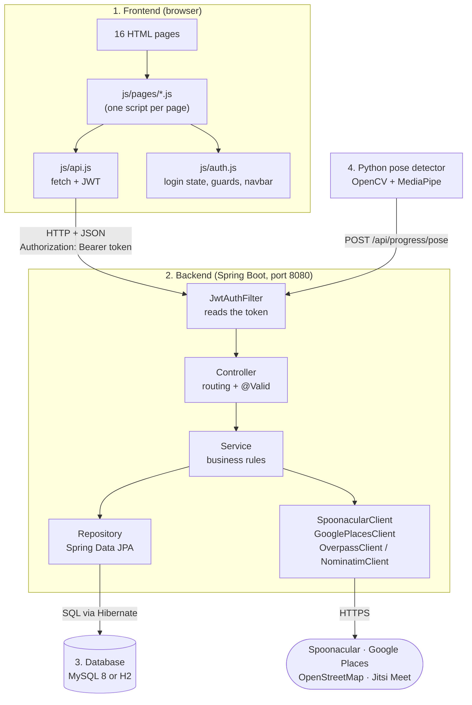
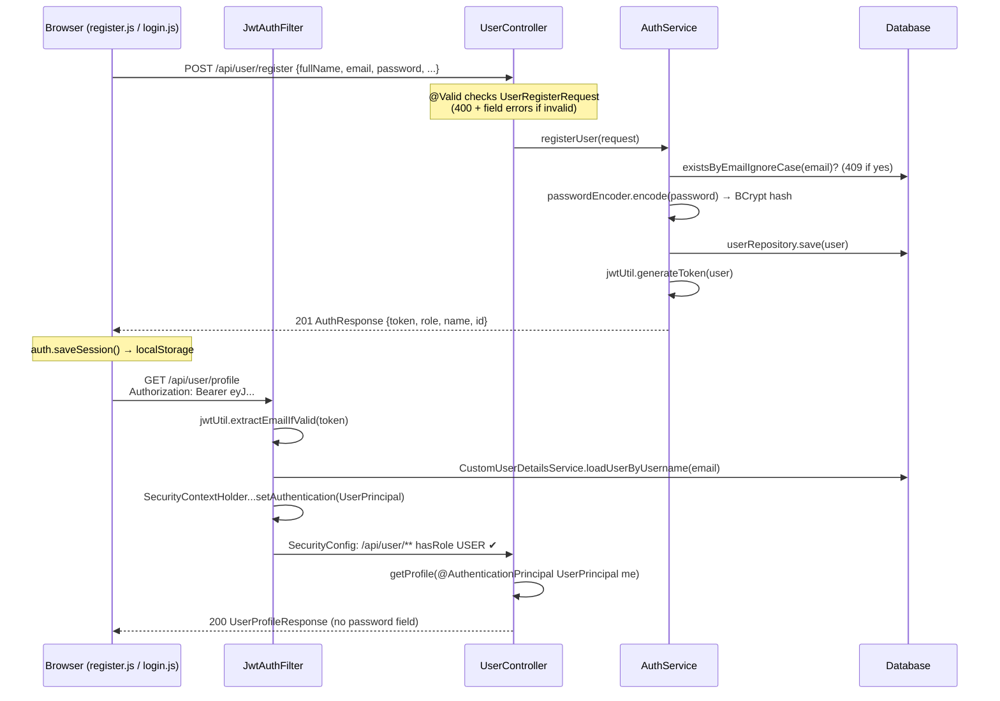

# FitFlex Learning Guide

Yeh guide tumhare liye hai: to understand FitFlex well enough to explain any part of it in your viva or
an interview. Read it next to the code. Every file and method name here exists in the project.

**Contents**

1. [Big picture](#1-big-picture)
2. [Folder by folder, file by file](#2-folder-by-folder-file-by-file)
3. [Four flows traced end to end](#3-four-flows-traced-end-to-end)
4. [Key concepts explained simply](#4-key-concepts-explained-simply)
5. [Suggested order to read the code](#5-suggested-order-to-read-the-code)
6. [30 viva / interview questions](#6-30-viva--interview-questions)
7. [Future scope](#7-future-scope)

---

## 1. Big picture

FitFlex has **four parts** that talk to each other:

1. **Frontend**: plain HTML/CSS/JavaScript. It never touches the database; it only calls the REST API
   with `fetch`. After login it keeps the JWT in `localStorage` and sends it in the `Authorization` header.
2. **Backend**: a Spring Boot REST API with a layered design:
   **Controller → Service → Repository → Database**. Security (JWT check, roles) runs *before* the controllers.
3. **Database**: MySQL in real use, or H2 in memory for quick runs and tests. Hibernate creates the tables from the `@Entity` classes.
4. **Python pose detector**: runs on your laptop with your webcam, and when you quit it logs in to the API
   and uploads the workout summary, exactly like the browser would.

**External APIs** are always called by the **backend**, never the browser, so keys stay secret. Each one
has a **fallback**: no Spoonacular key → local meal dataset; no Google key → OpenStreetMap. Jitsi needs
no key at all: a meeting room exists as soon as someone opens its URL.

---

## 2. Folder by folder, file by file

### `backend/` (Spring Boot)

| File | What it does |
|------|-------------|
| `pom.xml` | Maven build: Spring Boot 4.2 parent, dependencies (web, JPA, security, validation, jjwt, MySQL, H2, test libs). |
| `mvnw.cmd`, `.mvn/` | Maven **wrapper**: downloads the right Maven version, so Maven need not be installed. |
| `.env.example` | Template for your secrets (DB password, JWT secret, API keys). Copy to `.env` (gitignored). |
| `src/main/resources/application.properties` | All settings, read from env vars with defaults: `${DB_URL:jdbc:mysql://...}`. Imports `.env` with `spring.config.import`. |
| `src/main/resources/application-h2.properties` | The `h2` profile: in-memory database + H2 console. |
| `src/main/resources/fallback/meals.json` | 41 Indian-friendly meals (calories, protein, carbs, fat, diet type) for offline diet plans. |
| `src/main/resources/fallback/foods.json` | 40 common foods per 100 g for offline food search. |

**`com.fitflex` (the Java code)**

| Package / file | Role |
|---------------|------|
| `FitFlexApplication` | `main()` method; `@SpringBootApplication` starts everything. |
| **config/** | |
| `SecurityConfig` | The security rules: which URLs are public, which need USER/TRAINER, stateless sessions, BCrypt bean, adds `JwtAuthFilter`. |
| `CorsConfig` | Allows the frontend origin (Live Server port 5500) to call the API. |
| `RestClientConfig` | One shared `RestClient` with timeouts for calling external APIs. |
| `DataSeeder` | `CommandLineRunner` that fills an empty database with the demo user, 5 trainers, sessions, a plan and progress. |
| **security/** | |
| `JwtUtil` | `generateToken(User)` creates a signed JWT; `extractEmailIfValid(token)` verifies the signature and expiry. |
| `JwtAuthFilter` | Runs on every request: reads `Authorization: Bearer ...`, validates, and puts the user into the `SecurityContext`. |
| `CustomUserDetailsService` | `loadUserByUsername(email)`: loads the user from the DB for Spring Security. |
| `UserPrincipal` | The logged-in user (id, email, role) that controllers receive with `@AuthenticationPrincipal`. |
| `RestAuthErrorHandler` | Writes the JSON 401/403 errors produced inside the filter chain. |
| **entity/** | JPA classes = database tables. `User`, `Trainer`, `AvailabilitySlot`, `TrainingSession`, `WorkoutPlan`, `WorkoutExercise`, `TrainerResource`, `DietPlan`, `ProgressEntry`, `ContactMessage` + enums (`Role`, `Gender`, `FitnessGoal`, `FitnessLevel`, `ActivityLevel` with TDEE factors, `SessionType`, `SessionStatus`, `ResourceType`, `DietSource`, `ProgressSource`). |
| **repository/** | Interfaces extending `JpaRepository`. Spring writes the SQL from method names (`findByEmailIgnoreCase`) or `@Query` JPQL (`TrainerRepository.search`, `TrainingSessionRepository.findAllForUser`). |
| **dto/request/** | What clients send, with validation annotations (`UserRegisterRequest`, `BookSessionRequest`, `DietGenerateRequest` ...). `PasswordRules` holds the password regex. |
| **dto/response/** | What the API returns (`AuthResponse`, `TrainerResponse`, `SessionResponse`, `DietPlanResponse`, `ErrorResponse` ...). Each has a static `from(entity)` mapper. |
| **controller/** | `UserController` (/api/user), `TrainerController` (/api/trainer), `TrainersController` (public /api/trainers), `SessionController`, `WorkoutPlanController`, `ResourceController`, `NutritionController`, `GymController`, `ProgressController`, `ContactController`, `DashboardController`. |
| **service/** | `AuthService` (register/login), `UserService`, `TrainerService` (search, availability, **client** logic), `SessionService` (**booking rules**, status changes), `WorkoutPlanService`, `ResourceService` + `FileStorageService` (uploads), `NutritionService` (**BMR/TDEE**, plans) + `SpoonacularClient` + `LocalMealDataset` + `DietType`, `GymService` + `GooglePlacesClient` + `OverpassClient` + `NominatimClient`, `ProgressService` (streak, summary), `ContactService`, `DashboardService`. |
| **exception/** | `GlobalExceptionHandler` (`@RestControllerAdvice`) turns exceptions into the standard error JSON; `ResourceNotFoundException` (404), `BadRequestException` (400), `UnauthorizedException` (401), `ForbiddenException` (403), `ConflictException` (409). |

**Tests** (`src/test/java/com/fitflex/`): `service/AuthServiceTest`, `NutritionServiceTest`,
`SessionServiceTest`, `HelperLogicTest` (Mockito unit tests) and `controller/ApiIntegrationTest`
(MockMvc against the real app on H2).

### `frontend/`

| File | What it does |
|------|-------------|
| `css/style.css` | The whole theme. CSS variables in `:root` (colours, radius), components (cards, buttons, forms, tabs, toasts), responsive rules, `.reveal` fade-in animation. |
| `js/config.example.js` → `config.js` | `API_BASE_URL` and the optional Google Maps browser key. |
| `js/api.js` | `apiRequest()`: the only place that calls `fetch`. Adds the JWT, parses JSON, throws `ApiError`, handles 401. `api.download()` downloads protected files as a Blob. |
| `js/auth.js` | `saveSession`, `getUser` (also checks JWT expiry), `requireRole` (route guard), `logout`, and renders the navbar/footer by role. |
| `js/ui.js` | `escape` (XSS protection), `toast`, loaders, `validateForm`, formatting helpers, shared renderers (`trainerCard`, `workoutPlanHtml`). |
| `index.html` + `pages/home.js` | Home: hero, features, steps, featured trainers from the API. |
| `login.html`, `trainer-login.html` + `pages/login.js` | One script for both portals (`<body data-portal>` picks the endpoint). |
| `register.html`, `trainer-register.html` + `pages/register.js` | Registration forms for both portals. |
| `user-dashboard.html` + `pages/user-dashboard.js` | Stats, upcoming sessions, latest diet plan, workout plans, files from trainers. |
| `trainer-dashboard.html` + `pages/trainer-dashboard.js` | Tabs: requests (confirm/decline), clients, availability, group session, workout plan builder, uploads, profile. |
| `trainers.html` + `pages/trainers.js` | Search and filter trainer cards. |
| `trainer-profile.html` + `pages/trainer-profile.js` | Profile, availability table, booking form. |
| `sessions.html` + `pages/sessions.js` | Upcoming/past/group tabs, Join Session (Jitsi), role-based buttons. |
| `nutrition.html` + `pages/nutrition.js` | Generate plan, meals by type, macro doughnut chart, food search, history. |
| `gyms.html` + `pages/gyms.js` | Geolocation/city/lat-lng → API → Leaflet (or Google) map + list. |
| `progress.html` + `pages/progress.js` | Log form, summary cards, 3 Chart.js charts, recent entries table. |
| `pose.html` + `pages/pose.js` | Explains pose detection; shows your uploaded pose sessions. |
| `about.html`, `contact.html` + scripts | Static info; contact form → `POST /api/contact`. |

### `pose-detection/`

| File | What it does |
|------|-------------|
| `pose_utils.py` | `calculate_angle(a, b, c)` with `atan2`, `landmark_to_pixel`, visibility helpers, `line_y_at`, `MovingAverage`. |
| `pose_detector.py` | `CONFIG` thresholds; `SquatTracker`, `BicepCurlTracker`, `PlankTracker`; `pick_side_points`; drawing (`draw_panel`); `run()` loop; `login()` + `upload_summaries()`; `main()`. |
| `pose_detection.ipynb` | Teaching notebook (already executed). |
| `test_pose_utils.py`, `test_pose_detector.py` | 26 pytest tests. |
| `requirements.txt` | Pinned versions (MediaPipe 0.10.21, the last with `mp.solutions` on Windows). |

---

## 3. Four flows traced end to end

### (a) Register → login → JWT → calling a protected API

Step by step:

1. `register.js` validates the form in the browser (`ui.validateForm`), then calls `api.post("/user/register", data)`.
2. `api.js → apiRequest()` sends the JSON with `fetch`.
3. Spring maps the URL to `UserController.register()`. `@Valid` runs the annotations on
   `UserRegisterRequest` (`@NotBlank`, `@Email`, `@Pattern(PasswordRules.REGEX)` ...). If any fails, Spring
   throws `MethodArgumentNotValidException` and `GlobalExceptionHandler.handleValidation()` returns 400 with
   `errors: {field: message}`; `ui.showServerErrors()` puts them under the inputs.
4. `AuthService.registerUser()` lower-cases the email, checks `existsByEmailIgnoreCase` (409 `ConflictException`),
   hashes the password with BCrypt and saves the `User`.
5. `JwtUtil.generateToken()` builds the token: `subject` = email, claims `role` and `uid`, `issuedAt`,
   `expiration` = now + 24 h, signed with HMAC-SHA256.
6. The browser stores it via `auth.saveSession()` and redirects to `user-dashboard.html`.
7. **Login** is the same idea: `UserController.login()` → `AuthService.login(request, Role.USER)` checks the
   email exists, `passwordEncoder.matches(raw, hash)`, and that the role matches the portal.
8. **A protected call:** `api.js` adds `Authorization: Bearer <token>`. `JwtAuthFilter.doFilterInternal()`
   validates it, loads the user and stores a `UserPrincipal` in the `SecurityContext`. Then the rules in
   `SecurityConfig.securityFilterChain()` decide: no authentication → `RestAuthErrorHandler.commence()` (401);
   wrong role → `RestAuthErrorHandler.handle()` (403); otherwise the controller runs.
9. If a token expires, the API returns 401, and `apiRequest()` calls `auth.handleExpiredSession()`, which
   clears `localStorage` and redirects to login.

### (b) Booking a session → trainer confirms → Jitsi link

1. **User books.** `trainer-profile.js → setupBooking()` shows the trainer's slots for the chosen weekday and
   posts `{trainerId, scheduledAt: "2026-12-07T09:30", durationMinutes: 60}` to `/api/sessions/book`.
2. `SecurityConfig` allows `POST /api/sessions/book` only for `ROLE_USER`.
3. `SessionController.book()` → `SessionService.book(userId, request)`:
   - **Rule 1, future:** `start.isAfter(LocalDateTime.now())`, else `BadRequestException` (also `@Future` on the DTO).
   - **Same day:** the session must end on the day it starts.
   - **Rule 2, availability:** `ensureInsideAvailability()` loads the trainer's slots for that weekday
     (`AvailabilitySlotRepository.findByTrainerIdAndDayOfWeek`) and requires `slot.start ≤ start` and `end ≤ slot.end`.
     Otherwise 400 with the list of available hours.
   - **Rule 3, no clash:** `ensureNoClash()` fetches the trainer's REQUESTED/CONFIRMED sessions from 4 hours
     before until the end, and checks the overlap condition `otherStart < end && start < otherEnd`. Overlap → 409.
   - Saves a `TrainingSession` with status **REQUESTED** and no link.
4. **Trainer confirms.** `trainer-dashboard.js` shows `pendingRequests` from `GET /api/dashboard/trainer`.
   Clicking **Confirm** runs `changeStatus()` → `PUT /api/sessions/{id}/status {"status":"CONFIRMED"}`.
5. `SessionService.updateStatus()` → `updateAsTrainer()` checks the trainer owns the session and that the
   transition is allowed (only REQUESTED → CONFIRMED), then `newMeetingLink()` creates
   `https://meet.jit.si/FitFlex-<random UUID>`. JPA saves the change automatically when the
   `@Transactional` method ends ("dirty checking").
6. **User joins.** `sessions.js → sessionCard()` shows a **Join Session** button when
   `status === "CONFIRMED"` and `meetingLink` is present. `SessionResponse.from(session, viewerUserId)` only fills
   in the link for the trainer, the booker or participants, so strangers can't see it. Clicking opens Jitsi in a new tab.

### (c) Generating a diet plan (BMR → Spoonacular → fallback)

1. `nutrition.js → setupGenerateForm()` posts `{goal, dietType, mealsPerDay}` to `/api/diet/generate`.
2. `NutritionController.generate()` → `NutritionService.generate(userId, request)`:
   1. Loads the user and checks the profile has weight, height, age, gender and activity level.
   2. `DietType.fromLabel("vegetarian")` → enum.
   3. **BMR**, `calculateBmr()`: `10·weight + 6.25·height − 5·age + 5` (men) or `− 161` (women).
   4. **TDEE**, `calculateTdee()`: `BMR × ActivityLevel.getFactor()` (1.2 … 1.9).
   5. **Target**, `calculateTargetCalories()`: −500 (weight loss), +300 (muscle gain), 0 (maintenance), minimum 1200.
   6. `slotsFor(mealsPerDay)` splits calories between meals (e.g. 3 meals = 30% / 40% / 30%).
   7. **If no API key** (`SpoonacularClient.isConfigured()` is false) → `buildLocalPlan()`: for every slot,
      `LocalMealDataset.pickMeal()` picks one of the 3 meals closest to the slot's calories that fits the
      diet (`DietType.allows`) and scales the portion (0.5×–2×).
   8. **If a key is set** → `buildSpoonacularPlan()` calls `SpoonacularClient.generateDayPlan()`
      (`GET /mealplanner/generate`, then `/recipes/informationBulk` for macros). **If anything throws**
      (timeout, quota, bad JSON), the `catch` block falls back to `buildLocalPlan()` and the note explains why.
   9. Totals are summed, and everything is saved as a `DietPlan` with the meals as JSON text in `planJson`.
   10. `toResponse()` groups the meals by type (breakfast → dinner).
3. `nutrition.js → renderPlan()` shows the cards and `drawMacroChart()` draws the Chart.js doughnut (protein and
   carbs × 4 kcal/g, fat × 9 kcal/g).

**Example (demo user):** male, 75.5 kg, 175 cm, 24 years, moderate →
BMR = 755 + 1093.75 − 120 + 5 = **1733.75**; TDEE = 1733.75 × 1.55 = **2687.3**; weight loss → **2187 kcal**.

### (d) Pose detection: angle → rep counting → upload to progress

1. `pose_detector.py → main()` parses arguments and calls `run()`, which opens the webcam with OpenCV
   (`cv2.VideoCapture`).
2. For every frame: BGR → RGB, then `pose.process(rgb)` (MediaPipe) returns 33 landmarks with x, y as
   fractions and a visibility score.
3. `pick_side_points()` chooses the body side the camera sees best and converts the needed joints to pixels.
4. `SquatTracker.update(points, now)`:
   - `calculate_angle(hip, knee, ankle)` → knee angle; `calculate_angle(shoulder, hip, knee)` → torso angle;
     both smoothed by `MovingAverage` (5 frames).
   - State machine: knee < 140 → "squatting"; knee < 90 → stage `down`; knee > 160 → if the stage was `down`,
     **reps += 1** ("Good rep!"), and if it never got below 90 → "Go lower" (not counted).
   - Torso < 50 while squatting → issue "Keep chest up" → this frame counts as **wrong posture**.
   - `record_frame()` counts tracked and correct frames → `correct_form_percent`.
5. `draw_panel()` draws "Squats: N", "Knee: 92 deg", "Correct posture" / "Wrong posture!!", feedback and FPS.
6. On **q**, `run()` returns a `summary()` per exercise: `{exercise, reps, correctFormPercent, durationSeconds}`.
7. With `--upload`, `login()` calls `POST /api/user/login` to get a JWT (or uses `--token`), then
   `upload_summaries()` calls `POST /api/progress/pose` with `Authorization: Bearer ...`.
8. Backend: `ProgressController.logPose()` → `ProgressService.logPoseSession()` saves a `ProgressEntry` with
   `source = POSE_DETECTION`, minutes from the duration, and calories estimated if missing.
9. The website shows it: `progress.js` draws the "form accuracy" chart from POSE_DETECTION entries, and
   `ProgressService.getSummary()` averages `correctFormPercent` for the dashboard's "Avg. pose form accuracy".

---

## 4. Key concepts explained simply

**REST.** A style for web APIs: everything is a *resource* with a URL (`/api/trainers/1`), and the HTTP
*method* says what to do: GET read, POST create, PUT update, DELETE remove. It is **stateless**: each request
carries everything needed (here, the JWT). Status codes report the outcome (201 created, 404 not found ...).

**Layered architecture.** Each layer has one job, like a restaurant: the **controller** is the waiter (takes the
order, checks it is valid), the **service** is the chef (all the real work and rules), the **repository** is the
store room (gets and puts data). Benefits: logic is reusable and testable (we test `SessionService` without HTTP),
and changing the database doesn't touch business rules.

**DTO vs Entity.** An **entity** (`User`) maps to a table and has everything, including the password hash and lazy
relations. A **DTO** (`UserProfileResponse`) is exactly what the client should see. Returning entities would leak
the password, could cause infinite JSON loops (Trainer ↔ User), and ties the API to the table design. FitFlex's DTOs
are Java **records**: immutable classes whose constructor, getters, `equals` and `toString` are generated by Java.

**JPA relationships used here.**
- `@OneToOne`: `Trainer.user`, one trainer profile per account.
- `@ManyToOne` / `@OneToMany`: many `AvailabilitySlot`s → one `Trainer`; many `WorkoutExercise`s → one `WorkoutPlan`
  (`mappedBy`, `cascade = ALL`, `orphanRemoval`: saving/deleting the plan saves/deletes its exercises).
- `@ManyToMany`: `TrainingSession.participants` ↔ `User`, through the join table `session_participants`.
- `FetchType.LAZY`: related rows load only when accessed, inside a `@Transactional` service method (`open-in-view` is off).

**Spring Security filter chain.** Before a request reaches a controller it passes through a chain of filters. Ours:
CORS filter → **`JwtAuthFilter`** (token → `SecurityContext`) → authorization filter (the `requestMatchers` rules in
`SecurityConfig`). If authentication is missing → entry point → 401; if the role is wrong → access-denied handler → 403.
CSRF protection is off because we use a header token instead of cookies, and sessions are `STATELESS`.

**JWT (JSON Web Token).** Three Base64URL parts: `header.payload.signature`. The payload (email, role, expiry) is
*readable by anyone*, so never put secrets in it, but it **cannot be changed**: the signature is
HMAC-SHA256(header + payload, secret key) and only the server knows the key. The server stores nothing: it just
re-checks the signature and `exp` on each request. To log out, the browser deletes the token.

**BCrypt.** A slow, salted password hashing algorithm. "Salted" means a random value is mixed in, so the same
password gives different hashes and precomputed rainbow tables don't work. "Slow" (cost factor 10 = 2¹⁰ rounds)
makes brute force expensive. We never decrypt: `matches(raw, hash)` hashes the attempt the same way and compares.

**CORS.** Browsers block JavaScript on one *origin* (`http://127.0.0.1:5500`) from reading responses from another
(`http://localhost:8080`) unless the server allows it. For non-simple requests (JSON, `Authorization` header) the
browser first sends an `OPTIONS` **preflight**; `CorsConfig` answers with `Access-Control-Allow-Origin`. CORS
protects users in browsers; it is not API security (curl ignores it).

**fetch + async/await.** `fetch(url, options)` returns a *Promise* (a value that arrives later). `await` pauses the
`async` function until it arrives, without freezing the page, so the code reads top to bottom. `try/catch` handles
errors. Note that `fetch` only rejects on network failure; HTTP 4xx/5xx must be checked with `response.ok`, which `apiRequest()` does.

**localStorage.** A small key-value store in the browser per origin that survives page reloads and restarts. We
keep `fitflex_token` and `fitflex_user` there. Downside: any script on the page can read it, so we escape all
API data before inserting it into HTML (`ui.escape`) to prevent XSS. (Alternative: httpOnly cookies + CSRF protection.)

**Mifflin-St Jeor.** The most accurate common BMR formula for healthy adults (1990):
`BMR = 10·kg + 6.25·cm − 5·age + 5 (men) / − 161 (women)`. BMR = calories burned at complete rest.
TDEE = BMR × activity factor (1.2 sedentary to 1.9 very active). A 500 kcal/day deficit ≈ 0.5 kg fat loss per week
(about 7700 kcal per kg).

**Angle maths with atan2.** For points A, B, C: the direction of the line B→C is `atan2(Cy − By, Cx − Bx)`, and
likewise for B→A. Their difference is the angle at B. `atan2` (not `atan`) knows which quadrant the line points
into and handles vertical lines (dx = 0). We convert radians → degrees and use `360 − angle` if it is over 180,
since joints are measured on the inside. Pixels (not 0–1 fractions) are used because the frame isn't square.

---

## 5. Suggested order to read the code

1. `README.md` → run the app, click around with the demo accounts.
2. `entity/User.java`, `Trainer.java`, `TrainingSession.java`: the data model.
3. `repository/UserRepository.java`, `TrainerRepository.java`: how queries are made.
4. `controller/UserController.java` → `service/AuthService.java` → `security/JwtUtil.java`: flow (a).
5. `security/JwtAuthFilter.java`, `config/SecurityConfig.java`, `exception/GlobalExceptionHandler.java`.
6. `frontend/js/api.js`, `auth.js`, then `pages/login.js`: how the browser side works.
7. `service/SessionService.java` + `SessionServiceTest.java`: the booking rules and their tests (flow b).
8. `service/NutritionService.java`, `LocalMealDataset.java`, `SpoonacularClient.java` + `NutritionServiceTest.java` (flow c).
9. `service/GymService.java` and the three map clients, then `frontend/js/pages/gyms.js`.
10. `pose-detection/pose_utils.py` → `pose_detection.ipynb` → `pose_detector.py` (flow d).
11. `config/DataSeeder.java`, `controller/ApiIntegrationTest.java`, and the remaining pages.

---

## 6. 30 viva / interview questions

**Architecture and Spring**

1. **What is the architecture of FitFlex?** A layered client-server system: an HTML/JS frontend calls a Spring Boot REST API (controller → service → repository) backed by MySQL; a Python module does pose detection and uploads results through the same API.
2. **Why layered architecture?** Separation of concerns: each layer is simpler, reusable and testable on its own; business rules live in one place (services).
3. **What does `@SpringBootApplication` do?** It combines `@Configuration`, `@EnableAutoConfiguration` and `@ComponentScan`: it configures beans automatically from the classpath and finds our classes under `com.fitflex`.
4. **What is dependency injection? How do you use it?** Spring creates objects (beans) and passes their dependencies in. FitFlex uses constructor injection, e.g. `AuthService(UserRepository, TrainerRepository, PasswordEncoder, JwtUtil)`, which makes classes easy to test with mocks.
5. **`@RestController` vs `@Controller`?** `@RestController` = `@Controller` + `@ResponseBody`: return values are written as JSON instead of being resolved to view templates.
6. **How is validation done?** Bean Validation annotations on request DTOs (`@NotBlank`, `@Email`, `@Pattern`, `@Future`) plus `@Valid` in the controller; `GlobalExceptionHandler` returns 400 with field messages.
7. **How are errors handled consistently?** Services throw custom exceptions; `@RestControllerAdvice GlobalExceptionHandler` maps each to a status code and the same JSON shape `{timestamp, status, message, errors}`.
8. **Why DTOs instead of returning entities?** To hide sensitive fields (password), avoid lazy-loading and circular-reference problems, and keep the API stable if tables change.

**Data**

9. **Which JPA relationships did you use?** OneToOne (Trainer–User), OneToMany/ManyToOne (Trainer–AvailabilitySlot, WorkoutPlan–WorkoutExercise, sessions/resources/progress to user/trainer), ManyToMany (group session participants).
10. **What does `ddl-auto=update` do? Is it OK in production?** Hibernate creates or alters tables to match the entities on startup. It is fine for development; production should use migrations (Flyway/Liquibase) for controlled, versioned changes.
11. **What is `@Transactional` and where did you use it?** It runs a method in one database transaction (all or nothing) and keeps the session open for lazy loading. It is on service methods, e.g. `SessionService.book()`.
12. **Why is the table called `users`, not `user`?** `user` is a reserved word in MySQL/H2.
13. **How does the trainer search work with optional filters?** One JPQL query in `TrainerRepository.search` with `(:param IS NULL OR condition)` for each filter.

**Security**

14. **How does JWT authentication work here?** Login returns a signed token; the frontend sends it as `Bearer`; `JwtAuthFilter` verifies the signature and expiry, loads the user and sets the SecurityContext; `SecurityConfig` checks roles.
15. **Why stateless JWT instead of sessions?** No server-side session storage, easy horizontal scaling, works for the browser and the Python client alike.
16. **Can a user change their role inside the JWT?** They can edit the payload, but the signature would no longer match, so `Jwts.parser().verifyWith(key)` rejects it.
17. **How are passwords stored?** As BCrypt hashes with a random salt, never in plain text; login uses `passwordEncoder.matches()`.
18. **What is the difference between 401 and 403?** 401: not authenticated (no or invalid token). 403: authenticated, but not allowed (wrong role or not the owner).
19. **Why is CSRF disabled?** CSRF abuses cookies that browsers send automatically; our token is in a header added by JavaScript, so a forged cross-site request can't include it.
20. **What is CORS and why did you configure it?** A browser rule that blocks cross-origin responses; the frontend (port 5500) and API (8080) are different origins, so `CorsConfig` allows the frontend's origin.
21. **How do you secure file uploads?** Extension allow-list, 50 MB limit, sanitised display names, files stored under random UUID names (no path traversal), a resolve-and-check that paths stay inside `uploads/`, and downloads only for the owner trainer or their clients.

**Features**

22. **How do you prevent double booking?** `ensureNoClash()` checks overlap with the trainer's active sessions: `otherStart < newEnd && newStart < otherEnd` → 409.
23. **How is the meeting link generated?** On confirmation: `https://meet.jit.si/FitFlex-` + a random UUID. Jitsi creates the room when the first person opens the URL, and the UUID makes it unguessable.
24. **Explain the BMR/TDEE calculation.** Mifflin-St Jeor for BMR, multiplied by an activity factor for TDEE, then −500/+300/0 by goal with a 1200 kcal floor.
25. **What happens if the Spoonacular API is down?** The call throws, `NutritionService.generate()` catches it and builds the plan from the local dataset; the response's `source` and `note` say so. Gyms likewise go Google → Overpass → Nominatim → empty with a message.
26. **Why does the backend call external APIs instead of the browser?** It keeps API keys secret, avoids CORS issues with third parties, and lets us add fallbacks and caching in one place.

**Pose detection**

27. **How does pose detection work?** MediaPipe Pose finds 33 landmarks per frame; we compute joint angles with `atan2`, run a two-stage state machine per exercise to count reps, and apply threshold rules for form feedback.
28. **How do you count a squat rep?** The knee angle must drop below 90° (stage "down") and rise above 160°; the rep is counted on the down → up change. A partial squat gives "Go lower" and isn't counted.
29. **Why MediaPipe over OpenPose?** Higher accuracy in our comparison (90% vs 85%), it runs in real time on a CPU, and it installs with pip; OpenPose usually needs a GPU and complex setup.

**Testing**

30. **How did you test the project?** JUnit + Mockito unit tests for services (booking rules, BMR maths, auth), MockMvc integration tests on H2 for the HTTP layer and security, pytest for the angle function and rep counters, a Postman collection for every endpoint, and a manual run-through of the UI in a browser.

---

## 7. Future scope

- **Built-in video calls with WebRTC** instead of Jitsi links: a signalling server (Spring WebSocket) plus peer-to-peer video in the browser.
- **Real-time chat** between users and trainers with WebSocket/STOMP, and notifications when a booking is confirmed.
- **Browser pose detection** with MediaPipe Tasks for Web or TensorFlow.js (MoveNet): no Python install, the webcam stays in the browser, and results post straight to the API.
- **Mobile app** (Flutter or React Native) using the same REST API.
- **Cloud deployment**: Docker images for backend and frontend, managed MySQL (AWS RDS / Azure), files in S3 / Blob storage, HTTPS, CI/CD with GitHub Actions; Flyway for database migrations.
- **Payments** (Razorpay) for paid sessions, trainer ratings and reviews, admin verification of certificates.
- **Smarter plans**: weekly diet plans, grocery lists, workout plans adjusted from progress and pose accuracy.
